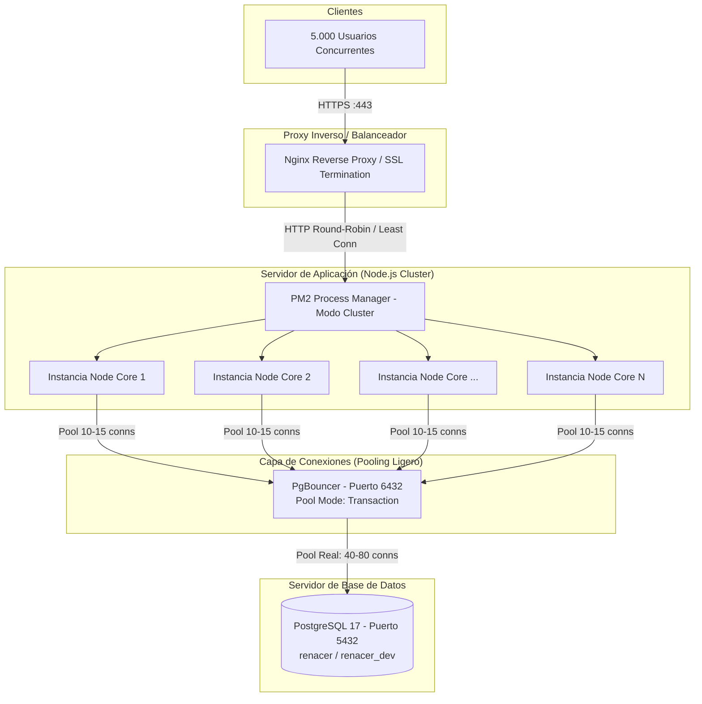

# Guía Técnica: Arquitectura y Optimizaciones para Alta Concurrencia (5.000 Usuarios)
## Sistema RENACER — Entorno de Producción

---

## 1. Arquitectura General de Alta Concurrencia

En una arquitectura monohilo típica de Node.js, un único proceso atiende todas las peticiones sobre un solo núcleo del procesador, y cada cliente web intenta abrir conexiones directas contra la base de datos PostgreSQL. Con una concurrencia masiva (como 5.000 usuarios virtuales), esto produce saturación inmediata de CPU en criptografía (`bcrypt`) y agotamiento de recursos/conexiones en PostgreSQL.

La arquitectura recomendada para producción distribuye la carga a través de capas desacopladas:



---

## 2. Pilar 1: Modo Clúster en Node.js con PM2

### 2.1. Justificación Técnica
- **Aprovechamiento multinúcleo:** Node.js es single-threaded por diseño en su bucle de eventos. Si el servidor tiene 8 o 16 vCPUs, un `node index.js` convencional solo usa el 12.5% o 6.25% de la capacidad de cómputo.
- **Distribución de CPU para `bcrypt`:** Al correr en modo clúster, las operaciones criptográficas intensivas de inicio de sesión (`comparePassword`) se balancean automáticamente entre todos los núcleos disponibles.
- **`UV_THREADPOOL_SIZE`:** La biblioteca `bcrypt` delega los cálculos pesados a los hilos de `libuv`. Por defecto Node.js solo tiene 4 hilos en este pool; aumentarlo a 64 o 128 permite procesar múltiples hashes concurrentemente sin encolar el bucle de eventos.
- **Cero tiempo de inactividad (Zero-Downtime Reloads):** Permite reiniciar workers de forma rotativa durante despliegues sin cortar conexiones activas.

### 2.2. Configuración en `ecosystem.config.js`
Actualización recomendada para el archivo `ecosystem.config.js` en la raíz del proyecto o en el servicio `auth`:

```javascript
module.exports = {
  apps: [
    {
      name: "auth-service",
      cwd: "/var/www/html/renacer/auth",
      script: "src/index.js",
      // 'max' genera un worker por cada núcleo CPU del servidor (o especificar número fijo, ej: 8)
      instances: "max",
      exec_mode: "cluster",
      autorestart: true,
      watch: false,
      max_memory_restart: "1G",
      env: {
        NODE_ENV: "development",
        PORT: 4110,
        UV_THREADPOOL_SIZE: 64
      },
      env_production: {
        NODE_ENV: "production",
        PORT: 4110,
        UV_THREADPOOL_SIZE: 128
      }
    },
    {
      name: "analytics-service",
      cwd: "/var/www/html/renacer/analytics",
      script: "src/index.js",
      instances: 2, // Analytics puede operar con 2 instancias clusterizadas
      exec_mode: "cluster",
      watch: false,
      env_production: {
        NODE_ENV: "production",
        PORT: 4120
      }
    }
  ]
};
```

### 2.3. Comandos de Gestión Operativa

```bash
# 1. Iniciar los servicios en modo clúster con entorno de producción
pm2 start ecosystem.config.js --env production

# 2. Monitoreo visual de consumo de CPU y memoria por worker
pm2 monit

# 3. Ver logs agrupados de todos los workers
pm2 logs auth-service

# 4. Despliegue de nuevas versiones sin desconectar usuarios (Zero-Downtime)
pm2 reload auth-service

# 5. Persistencia para arranque automático con el servidor (systemd)
pm2 save
pm2 startup
```

---

## 3. Pilar 2: Connection Pooling a Nivel de Aplicación (`pg.Pool`)

### 3.1. Reutilización de Conexiones en Controladores (Solución al Deadlock)
Uno de los principales cuellos de botella detectados durante pruebas de carga masiva ocurre cuando una petición invoca sub-funciones y cada una solicita una conexión independiente al pool (`pool.connect()`). En alta concurrencia, 50 peticiones simultáneas consumen 200 conexiones, agotando el pool y provocando `Error: timeout exceeded when trying to connect`.

**Regla de oro implementada en el código:**
1. Obtener una única conexión por solicitud HTTP: `const client = await pool.connect();`
2. Pasar `client` como parámetro a las funciones auxiliares (`getSessionTimeout(client)`, `getCooldownMinutes(client)`, etc.).
3. Liberar siempre en el bloque `finally`:
   ```javascript
   let client;
   try {
     client = await pool.connect();
     // Operaciones SQL usando client.query(...)
   } catch (error) {
     // Manejo de error
   } finally {
     if (client) client.release();
   }
   ```

### 3.2. Configuración del Pool en `auth/.env.production` y `src/db.js`

Cada worker del clúster de Node.js administra su propio mini-pool. Si tenemos 8 workers con un `DB_POOL_MAX=15`, el servidor de aplicaciones mantendrá un máximo de 120 conexiones abiertas hacia PgBouncer:

```ini
# Variables en .env.production
DB_POOL_MAX=15
DB_POOL_MIN=5
DB_POOL_CONNECT_TIMEOUT=15000
DB_POOL_IDLE_TIMEOUT=30000
```

---

## 4. Pilar 3: PgBouncer (Middleware de Pooling Ligero)

### 4.1. ¿Por qué PgBouncer es Indispensable ante 5.000 Usuarios?
En PostgreSQL tradicional:
- Cada conexión cliente crea un proceso del sistema operativo (`postgres: user db client`) que consume entre 5 MB y 15 MB de RAM.
- 5.000 conexiones directas requieren entre 25 GB y 75 GB de memoria RAM **únicamente para mantener las conexiones abiertas**, saturando la tabla de procesos del kernel Linux y colapsando el motor de base de datos.

PgBouncer resuelve esto actuando como un intermediario ultraligero que acepta miles de conexiones de red entrantes pero las canaliza hacia un número pequeño y eficiente de conexiones reales (40 - 80) hacia PostgreSQL.

### 4.2. Modo de Pooling: `transaction`
- **Session Pooling (Default):** Retiene la conexión física mientras el cliente esté conectado (no apto para APIs REST stateless).
- **Transaction Pooling (RECOMENDADO):** La conexión a PostgreSQL solo se toma prestada durante los milisegundos que dura la transacción (`BEGIN ... COMMIT`) o la consulta `SELECT/INSERT/UPDATE`. Al terminar la sentencia, la conexión física se entrega inmediatamente al siguiente usuario en cola.
- Con `transaction mode`, **80 conexiones reales en PostgreSQL pueden atender 5.000 usuarios concurrentes sin degradación**.

### 4.3. Configuración de PgBouncer (`/etc/pgbouncer/pgbouncer.ini`)

```ini
[databases]
; Redirecciona las bases de datos virtuales a PostgreSQL real en localhost o IP interna
renacer = host=127.0.0.1 port=5432 dbname=renacer auth_user=postgres
renacer_dev = host=127.0.0.1 port=5432 dbname=renacer_dev auth_user=postgres

[pgbouncer]
; Escucha en todas las interfaces o red interna en el puerto estándar 6432
listen_addr = 0.0.0.0
listen_port = 6432

; Autenticación
auth_type = md5
auth_file = /etc/pgbouncer/userlist.txt

; Modo transaccional óptimo para APIs REST
pool_mode = transaction

; Capacidad máxima de clientes concurrentes hacia PgBouncer
max_client_conn = 5000

; Conexiones reales hacia PostgreSQL por base de datos/usuario
default_pool_size = 50
min_pool_size = 15
reserve_pool_size = 10
reserve_pool_timeout = 5

; Tiempos de espera
server_idle_timeout = 60
server_connect_timeout = 15
client_idle_timeout = 60
client_login_timeout = 30
query_timeout = 60

; Parámetros de compatibilidad con drivers modernos (Node pg)
ignore_startup_parameters = extra_float_digits, application_name
```

### 4.4. Archivo de Usuarios (`/etc/pgbouncer/userlist.txt`)
```text
"postgres" "postgres"
```
*(O con el hash MD5 generado por PostgreSQL)*.

### 4.5. Despliegue Rápido con Docker (Alternativa)
Si se desea correr PgBouncer en contenedor en el servidor de base de datos:

```bash
docker run -d \
  --name pgbouncer \
  --restart always \
  -p 6432:6432 \
  -e DB_USER=postgres \
  -e DB_PASSWORD=postgres \
  -e DB_HOST=192.168.0.32 \
  -e DB_PORT=5432 \
  -e DB_NAME=renacer \
  -e POOL_MODE=transaction \
  -e MAX_CLIENT_CONN=5000 \
  -e DEFAULT_POOL_SIZE=50 \
  edoburu/pgbouncer:latest
```

---

## 5. Pilar 4: Ajustes del Motor PostgreSQL (`postgresql.conf`)

En el servidor de PostgreSQL (`192.168.0.32`), se debe asegurar que el motor esté afinado para un servidor con recursos de producción (ej. 16 GB RAM y 8 Cores):

| Parámetro | Valor Sugerido | Propósito |
| :--- | :--- | :--- |
| `max_connections` | `150` a `200` | Dado que PgBouncer agrupa las peticiones en 50-80 conexiones reales, un valor de 150-200 deja holgura suficiente para PgBouncer, tareas de mantenimiento y administradores. |
| `shared_buffers` | `4GB` | 25% de la RAM dedicado a la caché de tablas e índices en memoria. |
| `effective_cache_size`| `12GB` | Estimación para el planificador de consultas de la RAM disponible para caché de disco del SO. |
| `work_mem` | `32MB` | Memoria asignada para operaciones de ordenamiento (`ORDER BY`) y tablas hash. |
| `maintenance_work_mem`| `512MB` | Memoria para creación de índices y `VACUUM`. |
| `checkpoint_completion_target` | `0.9` | Distribuye la escritura de checkpoints en disco para evitar picos de I/O. |
| `wal_buffers` | `16MB` | Memoria intermedia para bitácora de transacciones antes de disco. |
| `random_page_cost` | `1.1` | Optimizado para almacenamiento en estado sólido (SSD / NVMe). |

Aplicación de cambios:
```bash
sudo systemctl restart postgresql
# o mediante comando SQL si no requiere reinicio:
SELECT pg_reload_conf();
```

---

## 6. Resumen de Flujo de Datos en Producción

1. **Cliente / Navegador:** Realiza una petición HTTPS al dominio público.
2. **Nginx:** Recibe en puerto 443, maneja el cifrado SSL/TLS, comprime con gzip/brotli y reenvía por HTTP interno al puerto 4110.
3. **PM2 Cluster:** Recibe en puerto 4110 y balancea mediante round-robin a nivel de SO entre los workers disponibles (ej. 8 núcleos).
4. **Node.js Worker:** Procesa la lógica de negocio; si requiere autenticación, computa `bcrypt` usando sus 128 hilos de `libuv`.
5. **Node pg.Pool:** Solicita una conexión ligera hacia el puerto `6432` de PgBouncer.
6. **PgBouncer:** Mantiene las 5.000 conexiones cliente esperando de forma no bloqueante; en cuanto una de las 50 conexiones físicas hacia PostgreSQL queda libre, le inyecta la consulta, recibe el resultado y la libera de inmediato.
7. **PostgreSQL:** Trabaja desahogado con solo 50 conexiones activas reales, utilizando el 100% de su CPU en procesamiento de consultas en lugar de gestión de memoria de conexiones.
